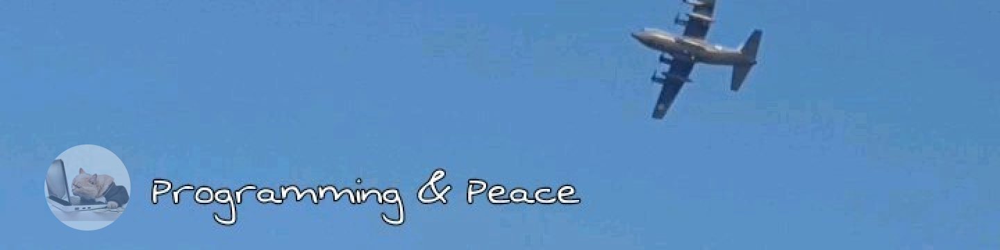

<div align="center">



<br/>

<a href="https://git.io/typing-svg">
  
</a>

<br/><br/>

[](https://portfolio-green-rho-70.vercel.app/)
[](https://linkedin.com/in/muhammad-usman-2b86232b1)
[](https://instagram.com/usman_jump)
[](mailto:usman03025@gmail.com)
[](https://uiverse.io/profile/Muhammad-Usman-911)

<br/>


</div>

---

## 👨‍💻 About Me

<table>
<tr>
<td valign="top" width="70%">

I'm a **Software Engineer** passionate about building scalable, efficient applications across **web, desktop, and mobile**. I love solving complex problems and constantly learning new technologies to expand my expertise.

```js
const usman = {
  role: "Software Engineer",
  focus: ["Full-Stack", "Desktop Apps", "Mobile"],
  currentlyLearning: ["Unity", "Machine Learning"],
  goal: "Game Developer + AI-driven apps 🎮",
  funFact: "I ship on web, desktop AND Android 😎",
};
```

</td>
<td valign="middle" align="center" width="30%">


</td>
</tr>
</table>

<table>
<tr>
<td width="50%" valign="top">

### 🔭 Currently Working On
- 🌐 Web apps with **React, Vite, Angular & Next.js**
- 🖥️ Desktop apps with **Electron**
- 🧩 Full-stack apps with **Nest.js, Node.js & Firebase**

### 👯 Open to Collaborate On
- Front-end & full-stack projects
- Open-source JavaScript / TypeScript projects
- Scalable desktop & web applications

</td>
<td width="50%" valign="top">

### 🤝 Looking for Help With
- Advanced machine learning techniques
- Large-scale architecture & performance optimization

### 💬 Ask Me About
- **Frontend:** React, Angular, Next.js
- **Backend:** Node.js, Nest.js, Firebase
- **Desktop:** Electron, Java, C#
- **Automation:** Web scraping & scripting
- **AI/ML:** Simple ML models & AI projects
- **Games:** Pygame, Unity *(in progress)*

</td>
</tr>
</table>

---

## 🚀 Portfolio

<div align="center">

### 👉 [**portfolio-green-rho-70.vercel.app**](https://portfolio-green-rho-70.vercel.app/) 👈

*Check out my projects, skills and experience.*

</div>

---

## 🛠️ Tech Stack

**Languages**


**Frontend**


**Backend & Desktop**

<br/>


**Databases & Cloud**


**Tools & Data**

<br/>


---

## 📊 GitHub Stats

<div align="center">


<br/><br/>


<br/><br/>


</div>

---

## 🤝 Let's Connect

Interested in collaborating, or have a project in mind? Reach out through my [portfolio](https://portfolio-green-rho-70.vercel.app/), the social links above, or email me directly at **[usman03025@gmail.com](mailto:usman03025@gmail.com)**.

<div align="center">

⭐ *Thanks for stopping by, and if you like my work, drop a star!* ⭐

<br/>


</div>
