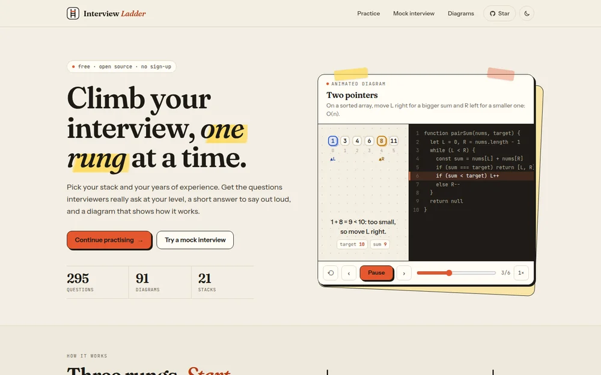
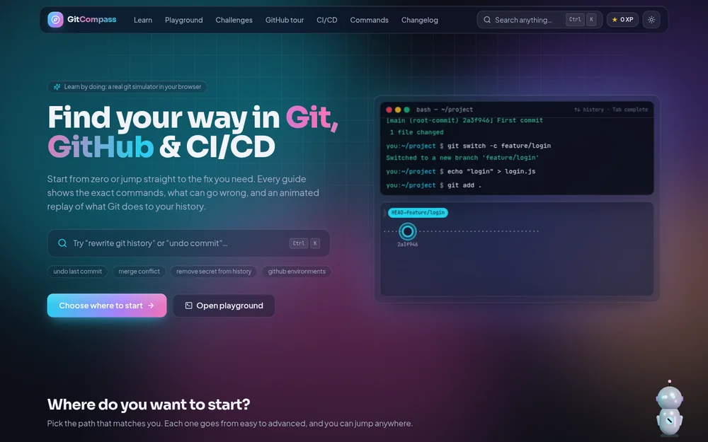

<div align="center">


<br/>

<a href="https://git.io/typing-svg">
  
</a>

<br/><br/>

<a href="https://portfolio-green-rho-70.vercel.app/"></a>
<a href="https://911muhammadusman.netlify.app/"></a>
<a href="https://portfolio-green-rho-70.vercel.app/"></a>

<br/>

<a href="https://www.linkedin.com/in/its-muhammad-usman-fullstackdev/"></a>
<a href="mailto:usman03025@gmail.com"></a>
<a href="https://uiverse.io/profile/Muhammad-Usman-911"></a>
<a href="https://instagram.com/usman_jump"></a>

<br/><br/>


</div>

---

## 👨‍💻 About Me

<table>
<tr>
<td valign="top" width="68%">

I'm a **graduated Software Engineer** (BS Software Engineering) and **Full Stack Developer** with **2+ years** of hands-on experience building production-ready **web, desktop and mobile** apps.

I build responsive front ends with **React, Next.js and Angular**, and solid back ends with **Node.js, NestJS, FastAPI, PostgreSQL and MongoDB**: real-time apps (**WebSockets, WebRTC, SSE**), AI integrations, multi-role workflows and automation tools. I care about clean architecture, performance (**Redis + TanStack Query**), security (**MFA + secure cookies**) and shipping (**Docker + Vercel**).

```js
const usman = {
  role: "Full Stack Developer @ EIE · Software Engineer @ Nexium",
  stack: ["React", "Next.js", "Angular", "NestJS", "FastAPI", "Electron"],
  realtime: ["WebSockets", "WebRTC", "Server-Sent Events"],
  currentlyLearning: ["Unity", "Machine Learning"],
  goal: "Ship great products → build my own original game 🎮",
  funFact: "I ship on web, desktop AND Android 😎",
};
```

</td>
<td valign="middle" align="center" width="32%">


<br/>

**2+** years building · **82** repos<br/>
**2.5k+** LinkedIn followers

</td>
</tr>
</table>

---

## 💼 Experience

| Role | Company | When |
| :-- | :-- | :-- |
| 🟢 **Full Stack Developer** | Electronic Interconnect Engineering (EIE) · Islamabad | Nov 2026 – Present |
| 🟢 **Software Engineer** *(part-time, hybrid)* | Nexium Technologies · Rawalpindi | Oct 2026 – Present |
| **Full Stack Web Developer** | BXTrack Solutions · Rawalpindi | Jan 2025 – Apr 2026 |
| **Freelance Developer** | Remote | May 2024 – Present |
| **MEAN Stack Developer** *(intern)* | NASTECSOL · Islamabad | Apr 2024 – Jun 2024 |
| 🎓 **BS Software Engineering** *(graduated)* | PMAS Arid Agriculture University | 2020 – 2024 |

<details>
<summary><b>⚡ Highlights from BXTrack</b></summary>
<br/>
https://911muhammadusman.netlify.app/ a POS app
- Improved performance with **Redis** and **TanStack Query**, and added **MFA** across projects

</details>

---

## 🚀 Featured Projects

<div align="center">

<b>Live now</b>&nbsp;&nbsp;
<a href="https://interviewladder.netlify.app/"></a>
<a href="https://gitcompass-seven.vercel.app/"></a>
<a href="https://autopilotweb.vercel.app/"></a>
<a href="https://ilmora-fe.vercel.app/"></a>
<a href="https://capturizy.vercel.app/"></a>
<a href="https://salemateweb.vercel.app/"></a>
<a href="https://videomanagerwebsite.vercel.app/"></a>
<a href="https://stampsheet.vercel.app"></a>
<a href="https://ocrxtrack.vercel.app/"></a>

</div>

<br/>

<table>
<tr>
<td width="50%" valign="top">

<a href="https://interviewladder.netlify.app/"></a>

<h3>🪜 Interview Ladder</h3>
<sub><b>OPEN SOURCE · EDTECH</b></sub>

<p>Free interview prep by <b>stack and level</b>: 295 questions across 21 stacks (now with the 7 OSI layers), each with an <b>animated diagram</b> that runs the real code. Mock interviews, no sign-up.</p>

<p><a href="https://interviewladder.netlify.app/"></a> <a href="https://github.com/Muhammad-Usman-911/Interview-Ladder"></a></p>

<p><code>React</code> <code>TypeScript</code> <code>Vite</code> <code>Tailwind</code> <code>Motion</code></p>

</td>
<td width="50%" valign="top">

<a href="https://gitcompass-seven.vercel.app/"></a>

<h3>🧭 Git Compass</h3>
<sub><b>WEB APP · EDTECH</b></sub>

<p>Learn Git, GitHub and CI/CD with an <b>in-browser git simulator</b> and an animated commit graph: 61 guides, challenges and a CI/CD lab, in a frosted-glass UI.</p>

<p><a href="https://gitcompass-seven.vercel.app/"></a> <a href="https://github.com/Muhammad-Usman-911/gitcompass"></a></p>

<p><code>React</code> <code>TypeScript</code> <code>Three.js</code> <code>Vitest</code></p>

</td>
</tr>
<tr>
<td width="50%" valign="top">

<a href="https://autopilotweb.vercel.app/"></a>

<h3>🤖 ApplyPilot</h3>
<sub><b>DESKTOP APP · AI</b></sub>

<p>Applies for jobs by email: a <b>free AI</b> writes a personal email for every recruiter, and Gmail sends them <b>in batches with pauses</b>, never twice.</p>

<p><a href="https://autopilotweb.vercel.app/"></a> </p>

<p><code>Electron</code> <code>React</code> <code>TypeScript</code> <code>Nodemailer</code></p>

</td>
<td width="50%" valign="top">

<a href="https://ilmora-fe.vercel.app/"></a>

<h3>📚 ILMORA</h3>
<sub><b>SAAS · AI</b></sub>

<p>AI quiz and learning platform for Pakistani schools: textbook-grounded questions with <b>RAG over pgvector</b>, teacher approval and a 3D guide bot.</p>

<p><a href="https://ilmora-fe.vercel.app/"></a> </p>

<p><code>Angular</code> <code>NestJS</code> <code>Prisma</code> <code>pgvector</code></p>

</td>
</tr>
<tr>
<td width="50%" valign="top">

<a href="https://capturizy.vercel.app/"></a>

<h3>🎬 Capturizy</h3>
<sub><b>SAAS · VIDEO</b></sub>

<p>Paste a repo or URL: it runs the app in a <b>Docker sandbox</b>, tours the screens and renders a <b>1080p60 launch video</b> with Remotion.</p>

<p><a href="https://capturizy.vercel.app/"></a> </p>

<p><code>Next.js</code> <code>Remotion</code> <code>Playwright</code> <code>BullMQ</code></p>

</td>
<td width="50%" valign="top">

<a href="https://salemateweb.vercel.app/"></a>

<h3>🛍️ SellMate</h3>
<sub><b>SAAS · DESKTOP</b></sub>

<p>Autopilot for businesses selling on Facebook: product library, <b>Messenger auto-replies</b> and bulk Marketplace listings, with licensing and installers.</p>

<p><a href="https://salemateweb.vercel.app/"></a> </p>

<p><code>Electron</code> <code>React</code> <code>Puppeteer</code> <code>SQLite</code></p>

</td>
</tr>
<tr>
<td width="50%" valign="top">

<a href="https://videomanagerwebsite.vercel.app/"></a>

<h3>📹 Video Manager</h3>
<sub><b>DESKTOP APP · LINUX</b></sub>

<p>Tray app that downloads <b>Hikvision NVR</b> recordings for the days and times you pick and uploads them to <b>MEGA or Google Drive</b>.</p>

<p><a href="https://videomanagerwebsite.vercel.app/"></a> <a href="https://github.com/Muhammad-Usman-911/videomanager-releases/releases"></a></p>

<p><code>Desktop</code> <code>Automation</code> <code>Auto-update</code></p>

</td>
<td width="50%" valign="top">

<a href="https://ocrxtrack.vercel.app/"></a>

<h3>🔎 ocrXtrack</h3>
<sub><b>WEB APP · OCR</b></sub>

<p>Reads CCTV timestamps and tables from photos <b>right in the browser</b>, nothing uploaded, then exports Excel, Word or PDF.</p>

<p><a href="https://ocrxtrack.vercel.app/"></a> </p>

<p><code>Next.js</code> <code>WebCodecs</code> <code>OCR</code> <code>TypeScript</code></p>

</td>
</tr>
<tr>
<td width="50%" valign="top">


<h3>🧠 CogniSense</h3>
<sub><b>FINAL YEAR PROJECT · ML</b></sub>

<p>A 5-step wizard and a <b>Random Forest</b> model recommend the best requirements-elicitation technique. Now a SaaS with Stripe plans.</p>

<p></p>

<p><code>React</code> <code>Node.js</code> <code>scikit-learn</code> <code>Firebase</code></p>

</td>
<td width="50%" valign="top">


<h3>🚀 Skybreaker: Alien Siege</h3>
<sub><b>GAME · PYGAME</b></sub>

<p>2D air-combat shooter with 5 missions and <b>multi-phase bosses</b>, all art drawn in code, with save files and tests.</p>

<p><a href="https://github.com/Muhammad-Usman-911/skybreaker"></a></p>

<p><code>Python</code> <code>pygame-ce</code> <code>Game AI</code></p>

</td>
</tr>
</table>

<details>
<summary><b>🎮 Games, mobile apps and more</b></summary>
<br/>

- 🎞️ [**StampSheet**](https://github.com/Muhammad-Usman-911/StampSheet-ElectronApp-VideotoExcel) · [live](https://stampsheet.vercel.app): desktop app that reads the clock in CCTV footage with offline OCR and writes the times to Excel (Electron, Tesseract.js, FFmpeg)
- 🥊 **Ember Clash** *(private)*: 1v1 fighting game with 4 fighters, a story ladder and versus mode (Python, Pygame)
- 🦘 **MRJumpY** *(private)*: 5-mission story platformer about jumping over everyday worries (Python, Pygame)
- 🎓 **Grade Wizard** *(private)*: GPA & CGPA calculator on official HEC, PU, FAST and ARID grading tables (React Native, Expo)
- 🐱 [**Cat Purgrammer**](https://github.com/Muhammad-Usman-911/myfirst_app): my first React Native app (Expo)
- 🔭 **KwanBall** *(private)*: Android astronomy app with NASA APIs and Firebase (Java)
- 🛒 **Acme Store** *(private)*: multi-brand store with Stripe Checkout (Angular, Express, Prisma)
- 💬 [**NestJS Chat Backend**](https://github.com/Muhammad-Usman-911/chatapp-backend): real-time chat with email-OTP sign-up, JWT guards, group chat over WebSockets and OpenAI replies (NestJS, Prisma, Socket.io)
- ⚡ [**FastAPI Starter**](https://github.com/Muhammad-Usman-911/PythonFastAPI_BASIC): auth with email codes, JWT refresh, Docker and CI (FastAPI, PostgreSQL)
- 🖥️ [**Vite + Electron + shadcn Starter**](https://github.com/Muhammad-Usman-911/Vite-Electron-ShadCn-AutoUpdater): desktop boilerplate with auto-updates

</details>

<div align="center">

🎬 *Every project on [**my portfolio**](https://portfolio-green-rho-70.vercel.app/) has a launch video: hover a card to watch it.*

**+ 60 more repos**: sliders, scroll animations, C# desktop apps and more → [**see all repositories**](https://github.com/Muhammad-Usman-911?tab=repositories)

</div>

---

## 🎨 Open-Source UI on Uiverse

I publish **MIT-licensed CSS components** on [Uiverse](https://uiverse.io/profile/Muhammad-Usman-911) as **MrJumpY**, used by developers worldwide.

`5 published elements` · `1.6K views` · `#114 active curator` · `3 Button Mastery challenges`

---

## 🧭 My Dev Journey

<details>
<summary><b>💻 C++: where it all started</b></summary>
<br/>
My first language, in my first semester at uni. I ran into <i>so many</i> bugs: segfaults, off-by-one loops, pointers pointing nowhere. Stack Overflow became my second home. Reading other people's answers taught me how to debug, and I then taught myself data structures and algorithms on my own.
</details>

<details>
<summary><b>☕ Java: OOP clicked, then Android</b></summary>
<br/>
After C++, Java is where OOP clicked for me. I used it for Android development (my KwanBall astronomy app with NASA APIs) and built desktop apps and socket-programming projects with it.
</details>

<details>
<summary><b>🪟 C#: shipping real desktop apps</b></summary>
<br/>
I built Windows desktop apps in C# with WinForms, which was the first time I shipped software with real windows, forms and data grids. It's also the language behind Unity, which I'm learning now.
</details>

<details>
<summary><b>🔥 Git: the war story</b></summary>
<br/>
I once accidentally pushed a file with credentials to a repo. Deleting it in a new commit isn't enough, because the secret still lives in history, and there were far too many commits to fix by hand. So I used <code>git-filter-repo</code> (a Python tool) and Git commands to rewrite the entire history and strip the file from every commit. Since then: <code>.gitignore</code> and <code>.env</code> files come first.
</details>

<details>
<summary><b>🎮 Games: why I code</b></summary>
<br/>
Games are why I started coding. Pygame taught me the game loop, sprites and collision detection, and I'm now learning <b>Unity</b>. My goal is to build my <b>own original game</b> from an idea I've had for a long time.
</details>

---

## 🛠️ Tech Stack

**Languages**


**Frontend**


**Backend, Real-time & Desktop**

<br/>


**Databases, Caching & Cloud**


**Tools, Data & Game Dev**

<br/>


<p><i>💡 Hover any tech on <a href="https://portfolio-green-rho-70.vercel.app/">my portfolio</a> to see an animated "how it works" diagram (SSE, WebSockets, WebRTC, Redis, JWT…).</i></p>

---

## 🤝 Open To

<table>
<tr>
<td width="50%" valign="top">

### 👯 Collaborate On
- Full-stack & front-end projects
- Real-time apps (chat, live dashboards, auctions)
- Electron desktop apps & automation tools
- Open-source JavaScript / TypeScript projects

</td>
<td width="50%" valign="top">

### 💬 Ask Me About
- **Frontend:** React, Next.js, Angular
- **Backend:** NestJS, Node.js, FastAPI
- **Real-time:** WebSockets, WebRTC, SSE
- **Desktop:** Electron, C# WinForms
- **Automation:** Puppeteer, Playwright, scraping
- **Games:** Pygame, Unity *(in progress)*

</td>
</tr>
</table>

---

## 📊 GitHub Stats

<div align="center">


<br/><br/>


<br/><br/>

</div>

---

## 📫 Let's Build Something

<div align="center">

I'm open to **full-time, part-time and freelance** work: on-site, hybrid or remote.

[](https://portfolio-green-rho-70.vercel.app/)
[](mailto:usman03025@gmail.com)
[](https://portfolio-green-rho-70.vercel.app/Muhammad-Usman-CV.pdf)

<br/>

⭐ *Thanks for stopping by, and if you like my work, drop a star!* ⭐

<br/>


</div>
